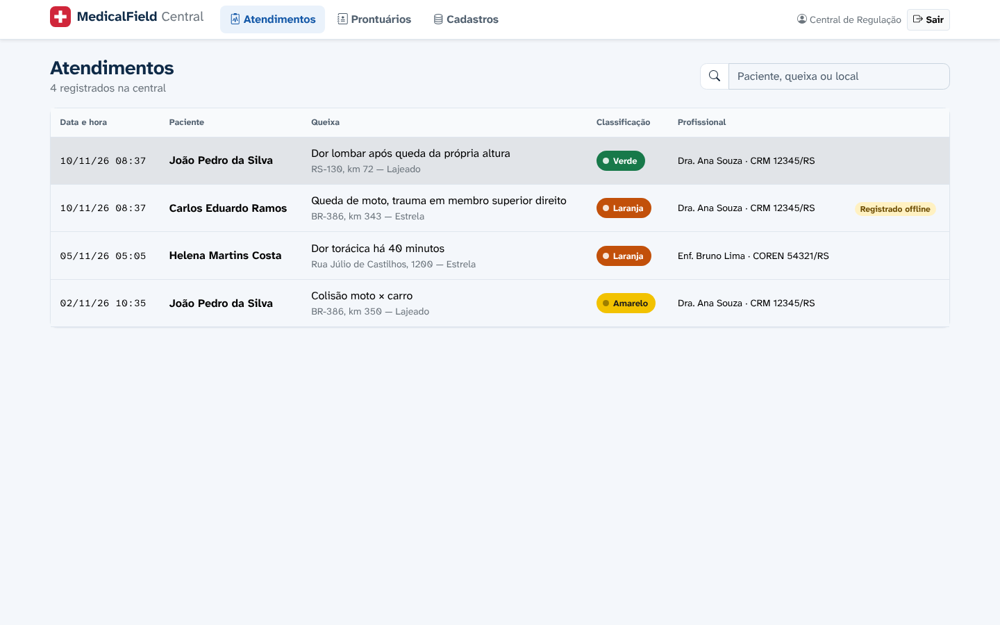
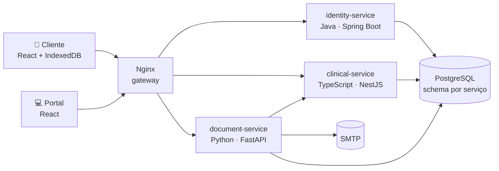

# MedicalField — Prontuário Médico de Emergência

Trabalho final de **4815206 – Arquiteturas de Software** (Univates, 2026/B).

O socorrista registra a ficha de atendimento pré-hospitalar no aparelho **mesmo sem internet**: sinais vitais, Escala de Glasgow, triagem START/Manchester e medicamentos, com as regras de segurança clínica rodando no próprio aparelho. Quando a conexão volta, tudo é sincronizado com a central sem duplicar e com **resolução de conflitos**. A central acompanha pelo portal, emite a ficha em PDF e a envia por e-mail ao familiar.

| Cliente (socorrista) | Portal (central) |
|---|---|
|  |  |

## Arquitetura



| Componente | Stack | Papel |
|---|---|---|
| `apps/client` | TypeScript · React · Bootstrap · Dexie | Ficha offline-first, chave Online/Offline, Outbox e sincronização |
| `apps/portal` | TypeScript · React · Bootstrap | Central: atendimentos, prontuários, cadastros, ficha PDF e e-mail |
| `packages/shared` | TypeScript · zod | Tipos, validações e regras clínicas, usados pelo cliente e pelo servidor |
| `packages/design` | CSS + fotos | Tema claro sobre Bootstrap ([DESIGN.md](DESIGN.md)) |
| `services/identity-service` | **Java 21** · Spring Boot | Login CRM/COREN/Socorrista, JWT RS256, logs do aparelho |
| `services/clinical-service` | **TypeScript** · NestJS | Pessoas, prontuários, atendimentos, idempotência, conflitos |
| `services/document-service` | **Python** · FastAPI | Ficha em PDF e e-mail com anexo |

Padrões de projeto: **Repository**, **Strategy** e **Observer** (exigidos), mais **Command**, **Chain of Responsibility**, **Builder** e **Adapter**.

## Rodar

**No Windows, siga o passo a passo em [COMO-RODAR.md](COMO-RODAR.md)** (instalação do WSL, download para a Área de Trabalho, logins e roteiro).

```bash
infra/scripts/start-all.sh          # sem Docker: banco, build, três serviços e Nginx
# Cliente:  http://localhost:8080/app/       CRM 12345 / RS · senha medicalfield
# Portal:   http://localhost:8080/portal/    ID Socorrista 0001 · senha medicalfield
# API:      http://localhost:8080/api        (coleção em postman/)
```

**Com Docker (VM da Univates)** — tudo em containers, um comando ([guia](docs/07-implantacao-vm.md)):

```bash
./mf.sh instalar-docker   # só na primeira vez
./mf.sh subir             # http://<ip>/app/ · /portal/ · /email/ · /api
./mf.sh ajuda             # status, logs, passo 9 do roteiro, zerar…
```

## Roteiro de testes

Os 17 passos oficiais rodam automaticamente no navegador, com portal e cliente lado a lado, e estão **aprovados 17/17**:

```bash
infra/scripts/reset-db.sh && infra/scripts/start-all.sh
cd tests/e2e && npm install && npx playwright install chromium && node roteiro.mjs
```

## Documentação

| # | Documento | Conteúdo |
|---|---|---|
| 01 | [Extração da proposta](docs/01-proposta.md) | Requisitos e onde cada um foi implementado |
| 02 | [Arquitetura](docs/02-arquitetura.md) | **E1** — diagramas, tecnologias, segurança, padrões, ADRs |
| 03 | [Offline-first e sincronização](docs/03-sincronizacao-offline.md) | Simulador, Outbox, recebimento por cursor, conflitos, regras clínicas offline |
| 04 | [APIs](docs/04-apis.md) | **E2** — rotas e contratos dos três serviços |
| 05 | [Banco de dados](docs/05-banco-de-dados.md) | **E2** — PostgreSQL (três schemas) e IndexedDB |
| 06 | [Roteiro de testes](docs/06-roteiro-testes.md) | **E3** — 17 passos, capturas e testes automatizados |
| 07 | [Implantação na VM](docs/07-implantacao-vm.md) | Nginx, systemd, e-mail, operação |
| 08 | [Desenvolvimento](docs/08-desenvolvimento.md) | Estrutura do código e testes |
| — | [DESIGN.md](DESIGN.md) · [PRODUCT.md](PRODUCT.md) | Sistema de design (Impeccable) |

Todos os pacientes e dados pessoais do sistema são fictícios. Fotos: Wikimedia Commons, domínio público ([créditos](packages/design/img/CREDITOS.md)).
