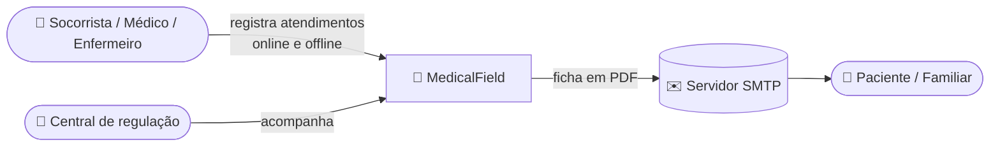
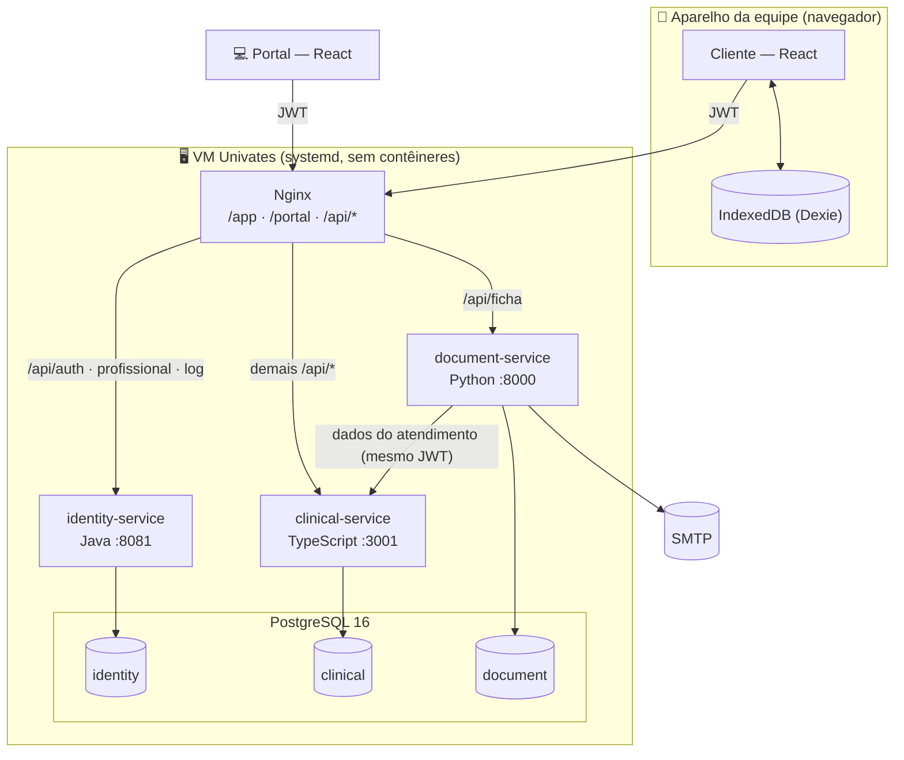
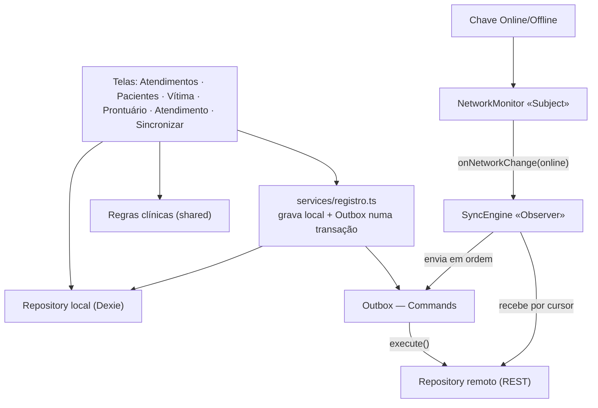
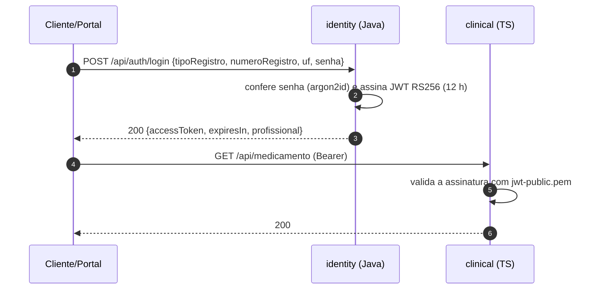
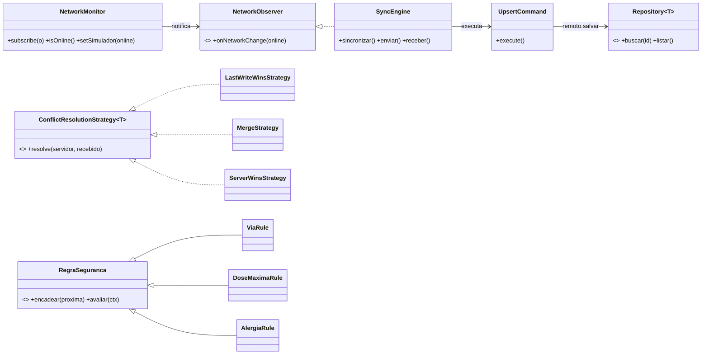
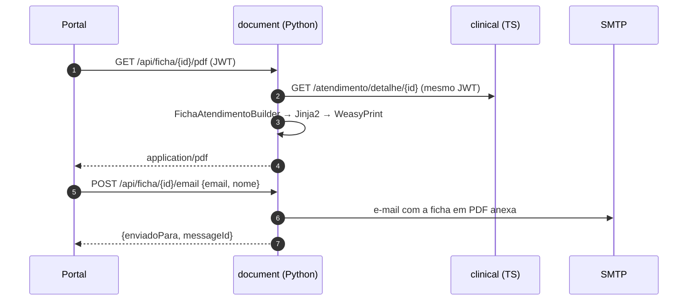

# 02 — Modelo de Arquitetura (Entregável E1)

## 1. Visão geral

| Componente | Linguagem / stack | Porta | Responsabilidade |
|---|---|---|---|
| **Cliente** (`apps/client`) | TypeScript · React 18 · Bootstrap 5 · Dexie (IndexedDB) | `/app` | Ficha do socorrista, simulador Online/Offline, Outbox e sincronização |
| **Portal** (`apps/portal`) | TypeScript · React 18 · Bootstrap 5 | `/portal` | Central: atendimentos, prontuários, cadastros, ficha PDF e e-mail |
| **`packages/shared`** | TypeScript · zod | — | Tipos, validações, escalas e regras de segurança clínica (cliente e servidor) |
| **`packages/design`** | CSS (tema sobre Bootstrap) + fotos | — | Tema claro, fontes e imagens ([DESIGN.md](../DESIGN.md)) |
| **identity-service** | **Java 21 · Spring Boot 3.3** · Spring Security · JDBC · Flyway · Nimbus JOSE · Argon2 | 8081 | Login CRM/COREN/Socorrista, JWT RS256, profissionais, logs do aparelho |
| **clinical-service** | **TypeScript · Node 22 · NestJS 10** · node-postgres | 3001 | Pessoas, prontuários, atendimentos, medicamentos, idempotência, conflitos, pull |
| **document-service** | **Python 3.12+ · FastAPI** · SQLAlchemy · Jinja2 + WeasyPrint · smtplib | 8000 | Ficha em PDF e envio por e-mail |
| **Nginx** | — | 80 (VM) / 8080 (local) | Gateway: serve as telas e roteia `/api/*` |
| **PostgreSQL 16** | — | 5432 | Um *schema* e um usuário por serviço |

**Por que essas linguagens:** TypeScript é a linguagem principal — cliente, portal e núcleo clínico compartilham os tipos e a regra de segurança clínica, escrita uma vez. Java/Spring é referência em autenticação. Python tem as melhores bibliotecas de PDF e e-mail. São três linguagens, como pede o RNF01.

## 2. Diagrama de contexto (C4 — nível 1)



## 3. Diagrama de contêineres (C4 — nível 2)



| Princípio | Aplicação |
|---|---|
| Banco por serviço | Cada serviço tem *schema* e usuário próprios; integração só por HTTP. |
| Offline-first | O cliente sempre grava primeiro no IndexedDB + Outbox; estando online, a Outbox é enviada na hora. |
| Serviços sem estado | JWT RS256: clinical e document validam com a chave pública, sem chamar o identity. |
| Escrita idempotente | Toda escrita aceita `Idempotency-Key`; um reenvio devolve a resposta original. |

## 4. Arquitetura do cliente



**Regra:** a tela nunca chama a API para gravar. A escrita vai ao banco local e gera um *Command* na Outbox na mesma transação; o `SyncEngine` é quem conversa com a central.

## 5. Arquitetura dos serviços

```
HTTP → [log de acesso] → [autenticação JWT] → controller → serviço → PostgreSQL (schema próprio)
```

| Camada | identity (Spring Boot) | clinical (NestJS) | document (FastAPI) |
|---|---|---|---|
| Log de acesso | `AccessLogFilter` (antes do Spring Security) | middleware Express | `@app.middleware("http")` |
| Autenticação | Spring Security + filtro JWT (Nimbus) | `JwtAuthGuard` global | dependência `usuario_atual` (PyJWT) |
| Validação | Bean Validation | schemas **zod** de `packages/shared` | Pydantic |
| Persistência | Spring JDBC + Flyway | node-postgres + migrações SQL | SQLAlchemy |
| Erros | Problem Details (RFC 7807) | Problem Details | Problem Details |

## 6. Segurança



| Aspecto | Decisão |
|---|---|
| Credenciais | `CRM` / `COREN` (com UF) ou `SOCORRISTA`, + senha (argon2id). |
| Token | JWT RS256 com `sub`, `nome`, `papel` e `exp`. Só `POST /auth/login` é público. |
| Portal | Restrito ao papel `ADMIN`. |

### Log de acesso (RNF05)

Os três serviços gravam cada requisição na tabela `access_log` do seu *schema*: **data_hora, ip_cliente, profissional_id, metodo, rota, status_code, tempo_ms**. Para ver: `SELECT * FROM clinical.access_log ORDER BY id DESC LIMIT 20;` (idem `identity` e `document`).

## 7. Padrões de projeto

| Padrão | Onde | Papel |
|---|---|---|
| **Repository** ⭐ | `apps/client/src/data/repositories.ts` | `local.*` (Dexie) e `remoto.*` (REST) atrás da mesma interface. |
| **Strategy** ⭐ | `services/clinical-service/src/sync/strategies.ts` | Resolução de conflitos: `LastWriteWins` (pessoa), `Merge` (prontuário: une alergias), `ServerWins` (atendimento). |
| **Observer** ⭐ | `apps/client/src/sync/network.ts` → `engine.ts` | O `NetworkMonitor` avisa o `SyncEngine`; ao voltar a rede, a Outbox é enviada. |
| **Command** | `apps/client/src/sync/commands.ts` | Cada item da Outbox é um comando reexecutável e idempotente. |
| **Chain of Responsibility** | `packages/shared/src/clinical/safety.ts` | Via → Dose máxima → Alergia, no aparelho e no servidor. |
| **Builder** | `services/document-service/app/ficha/builder.py` | `FichaAtendimentoBuilder` monta a ficha seção por seção. |
| **Adapter** | `services/document-service/app/email/adapters.py` | Envio por SMTP ou gravação em arquivo `.eml`, atrás da mesma interface. |

⭐ = exigidos pela proposta.



## 8. Ficha em PDF e e-mail



Sem `SMTP_HOST` configurado, o e-mail completo (com anexo) é gravado como `.eml` em `.runtime/mail/` — útil se a VM bloquear SMTP.

## 9. Decisões arquiteturais (ADRs)

| # | Decisão | Alternativas | Motivo |
|---|---|---|---|
| 01 | Cliente **web React + IndexedDB (Dexie)** | Flutter/SQLite, Electron | Roda no navegador da apresentação e no celular; mesma stack do portal. |
| 02 | **PostgreSQL** único, *schema* por serviço | Um SGBD por serviço | Uma instância na VM, com isolamento e usuários separados. |
| 03 | **JWT RS256** com chave pública em arquivo | HS256 compartilhado | Só o identity assina. |
| 04 | **UUID v7 gerado no aparelho** | Id sequencial no servidor | Cria registros offline sem colisão. |
| 05 | Outbox enviada pelos **endpoints da proposta** | `POST /sync/push` em lote | Um só caminho de escrita, testável no Postman. |
| 06 | **Pull por cursor** (`change_seq` preenchido por *trigger*) | `updatedSince` por data | Não depende do relógio; capta inserções direto no banco (passo 9). |
| 07 | **Nginx + systemd** | Docker | A proposta dispensa contêineres. |
| 08 | **Bootstrap 5** com tema próprio | CSS do zero | Telas consistentes e responsivas com pouco código. |
