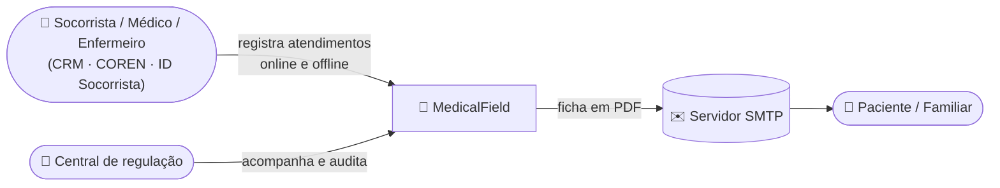
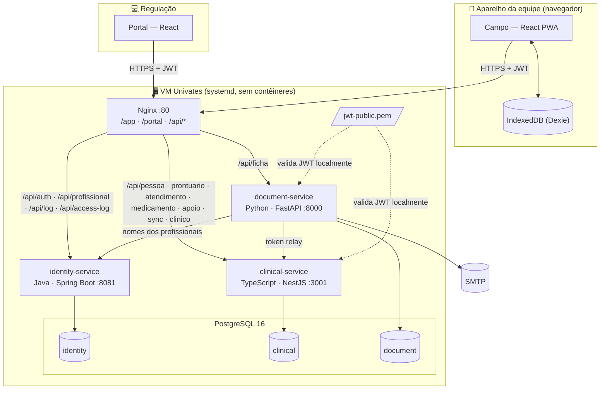
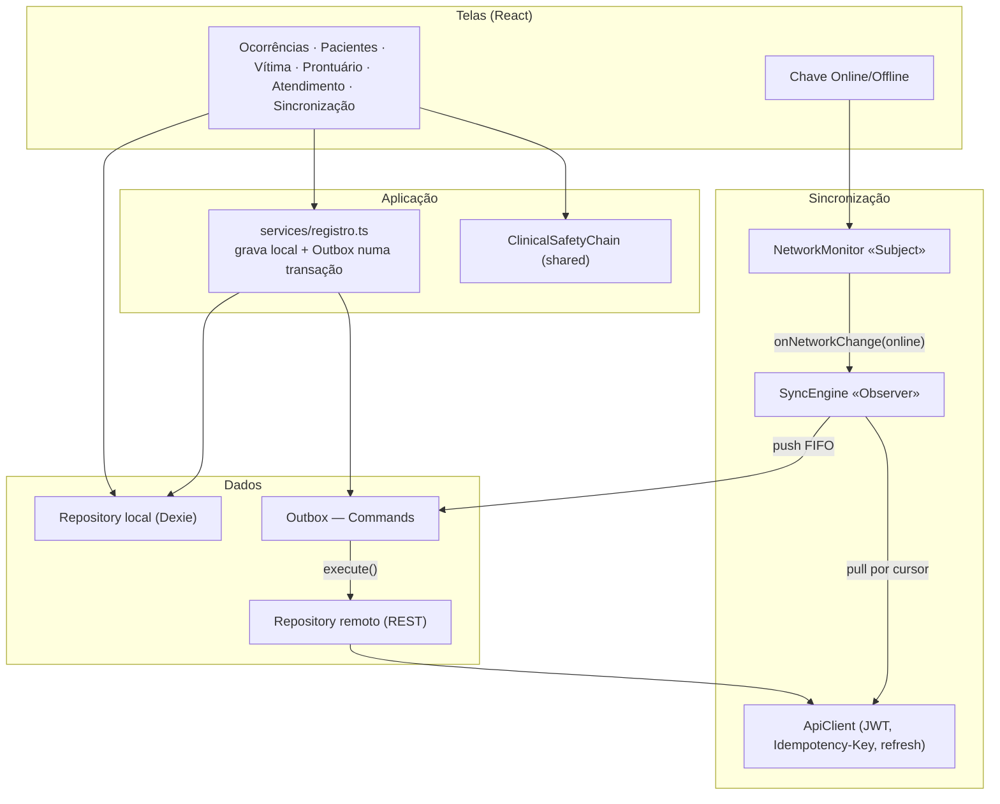
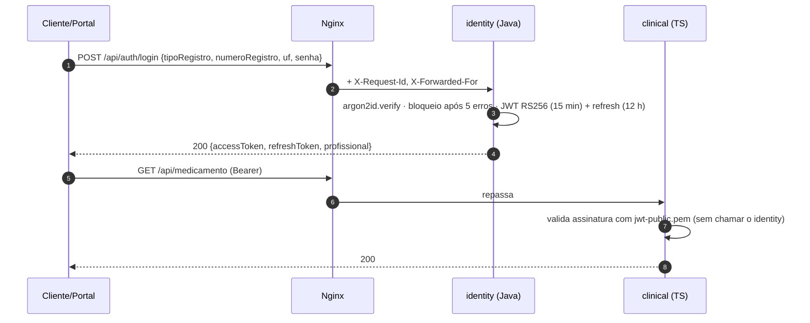
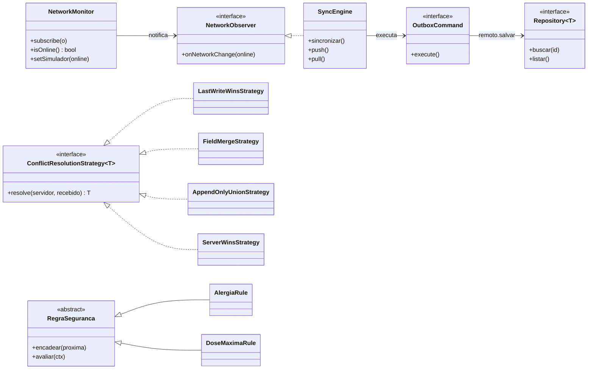
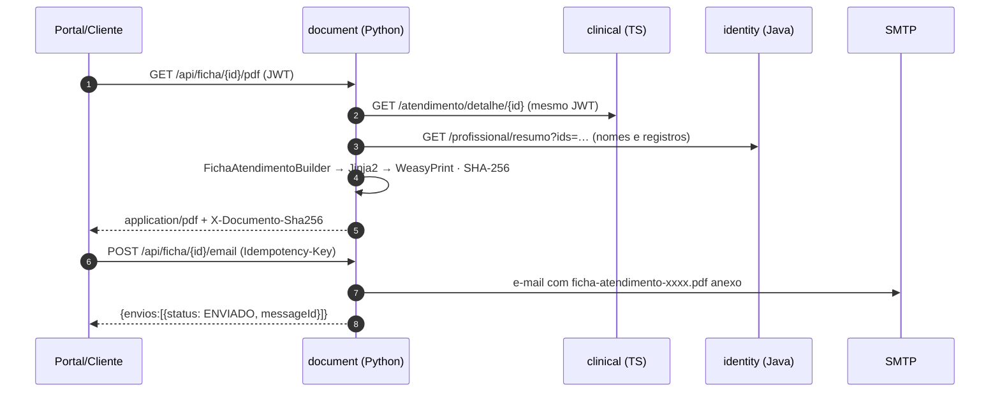

# 02 — Modelo de Arquitetura (Entregável E1)

## 1. Visão geral

| Componente | Linguagem / stack | Porta | Responsabilidade |
|---|---|---|---|
| **MedicalField Campo** (`apps/client`) | TypeScript · React 18 · Vite · Dexie (IndexedDB) · PWA | `/app` | Ficha offline-first, simulador de rede, Outbox, sincronização, login offline |
| **MedicalField Portal** (`apps/portal`) | TypeScript · React 18 · Vite | `/portal` | Regulação: atendimentos, prontuários, cadastros, auditoria (somente leitura) |
| **`packages/shared`** | TypeScript · zod | — | Tipos do domínio, schemas de validação, escalas e `ClinicalSafetyChain` (usado pelo cliente, portal e clinical-service) |
| **`packages/design`** | CSS | — | Tokens, fontes e componentes visuais ([DESIGN.md](../DESIGN.md)) |
| **identity-service** | **Java 21 · Spring Boot 3.3** · Spring Security · Spring JDBC · Flyway · Nimbus JOSE · Argon2 | 8081 | Login CRM/COREN/Socorrista, JWT RS256, refresh, profissionais, `POST /log` |
| **clinical-service** | **TypeScript · Node 22 · NestJS 10** · node-postgres · migrações SQL | 3001 | Pessoas, prontuários, atendimentos, catálogo, idempotência, conflitos, pull por cursor |
| **document-service** | **Python 3.12+ · FastAPI** · SQLAlchemy · Jinja2 + WeasyPrint · smtplib | 8000 | Ficha em PDF e envio por e-mail |
| **Nginx** | — | 80 (VM) / 8080 (local) | Gateway: roteia `/api/*`, serve as SPAs, injeta `X-Request-Id`/`X-Forwarded-For` |
| **PostgreSQL 16** | — | 5432 (localhost) | Um *schema* e um usuário por serviço |

**Por que essas linguagens:** TypeScript é a linguagem principal (cliente, portal e núcleo clínico compartilham tipos, validações e a regra de segurança clínica — escritas uma vez). Java/Spring é referência em autenticação (Spring Security). Python tem as melhores bibliotecas de PDF e e-mail. As três atendem o RNF01.

## 2. Diagrama de contexto (C4 — nível 1)



## 3. Diagrama de contêineres (C4 — nível 2)



| Princípio | Aplicação |
|---|---|
| Database per service | Cada serviço tem *schema* e usuário próprios, sem permissão nos outros; integração só por HTTP. |
| Offline-first | O cliente sempre grava primeiro no IndexedDB + Outbox; “online” só significa que a Outbox é drenada na hora. |
| Serviços sem estado | JWT RS256; clinical e document validam com a chave pública, sem chamar o identity. |
| Idempotent Receiver | Toda escrita aceita `Idempotency-Key` e devolve a resposta original num reenvio. |
| Auditoria em camadas | Log de acesso nos 3 serviços + logs do aparelho + histórico de operações e conflitos. |

## 4. Arquitetura do cliente



**Regra de ouro:** a interface nunca chama a API para gravar. A escrita vai ao banco local e gera um *Command* na Outbox na mesma transação; o `SyncEngine` é quem fala com a central.

## 5. Arquitetura dos serviços

```
HTTP → [log de acesso] → [autenticação JWT] → controller → serviço → repositório → PostgreSQL (schema próprio)
```

| Camada | identity (Spring Boot) | clinical (NestJS) | document (FastAPI) |
|---|---|---|---|
| Log de acesso | `AccessLogFilter` (`OncePerRequestFilter`, antes do Spring Security) + gravação em lote | middleware Express + fila em lote | `@app.middleware("http")` + thread gravadora |
| Autenticação | Spring Security + `JwtAuthFilter` (Nimbus) | `JwtAuthGuard` global (`crypto.verify` RS256) + `@Papeis` | dependência `usuario_atual` (PyJWT) |
| Validação | Bean Validation | schemas **zod** de `packages/shared` | Pydantic |
| Persistência | Spring JDBC | node-postgres | SQLAlchemy Core |
| Migrações | Flyway (`db/migration`) | migrador próprio (`migrations/*.sql` + `seeds/demo.sql`) | `migrations/001_schema.sql` na subida |
| Erros | Problem Details (RFC 7807) | Problem Details | Problem Details |

## 6. Segurança



| Aspecto | Decisão |
|---|---|
| Credenciais | `CRM` / `COREN` (com UF) ou `SOCORRISTA`, + senha (argon2id). 5 tentativas erradas bloqueiam por 15 min. |
| Token | JWT RS256 com `sub`, `nome`, `papel` (`MEDICO`, `ENFERMEIRO`, `SOCORRISTA`, `ADMIN`), `registro`, `exp`, `jti`. |
| Refresh | Token opaco guardado como SHA-256, com rotação a cada uso; `POST /auth/logout` revoga. |
| Autorização | Portal e rotas de auditoria exigem `ADMIN`; medicamento controlado só por `MEDICO`/`ENFERMEIRO` (regra clínica). |
| Login offline | Credencial derivada com PBKDF2-SHA256 (150 000 iterações, @noble/hashes) guardada no IndexedDB. |

### Log de acesso (RNF05)

Cada serviço grava, em `<schema>.access_log` e em JSON no stdout: **data_hora, ip_cliente, profissional_id, metodo, rota, status_code, tempo_ms**, além de `request_id` (correlação vinda do Nginx), caminho e user-agent. O portal mostra os três logs em **Auditoria → Acessos às APIs**.

## 7. Padrões de projeto

| Padrão | Onde | Papel |
|---|---|---|
| **Repository** | `apps/client/src/data/repositories.ts` | `local.*` (Dexie) e `remoto.*` (REST) atrás da mesma interface `Repository<T>`. |
| **Strategy** | `services/clinical-service/src/sync/strategies.ts` | `LastWriteWinsStrategy`, `FieldMergeStrategy`, `AppendOnlyUnionStrategy`, `ServerWinsStrategy`. |
| **Observer** | `apps/client/src/sync/network.ts` → `engine.ts` | O `NetworkMonitor` notifica o `SyncEngine` e a casca; ao voltar a rede, a Outbox é drenada. |
| **Command** | `apps/client/src/sync/commands.ts` | Cada item da Outbox (`UpsertPessoa/Prontuario/AtendimentoCommand`) é reexecutável e idempotente. |
| **Chain of Responsibility** | `packages/shared/src/clinical/safety.ts` | Inativo → Controlado → Via → Dose máxima → Dose diária → Alergia → Intervalo. |
| **Builder** | `services/document-service/app/ficha/builder.py` | `FichaAtendimentoBuilder` monta a ficha seção por seção. |
| **Adapter** | `services/document-service/app/email/adapters.py` | `SmtpEmailAdapter` e `ArquivoEmailAdapter` atrás de `EmailSender`. |



## 8. Ficha em PDF e e-mail



O PDF de cada versão do atendimento é gerado uma vez e reaproveitado (`documento_gerado`). Sem `SMTP_HOST`, o e-mail completo (com anexo) é gravado como `.eml` — útil para desenvolvimento e para a apresentação se a VM bloquear SMTP.

## 9. Decisões arquiteturais (ADRs)

| # | Decisão | Alternativas | Motivo |
|---|---|---|---|
| 01 | Cliente **PWA React + IndexedDB (Dexie)** | Flutter/SQLite, Electron | Roda no navegador da apresentação e no celular; mesma stack do portal. |
| 02 | **PostgreSQL** único, *schema* por serviço | Um SGBD por serviço; NoSQL | Uma instância na VM, com isolamento lógico e usuários separados. |
| 03 | **JWT RS256** com chave pública em arquivo | HS256 compartilhado; JWKS público | Só o identity assina; nenhuma rota pública além do login. |
| 04 | **UUID v7 gerado no aparelho** | Id sequencial no servidor | Cria registros offline sem colisão nem remapeamento. |
| 05 | Outbox drenada pelos **endpoints da proposta** | `POST /sync/push` em lote | Um único caminho de escrita, testável no Postman. |
| 06 | **Pull por cursor** (`change_seq` por *trigger*) | `updatedSince` | Imune a relógio errado; capta inserções feitas direto no banco (passo 9). |
| 07 | **Nginx + systemd** | Docker Compose | A proposta dispensa contêineres. |
| 08 | Atendimento **FINALIZADO é imutável** (correção por adendo) | Edição livre | Prática de prontuário; simplifica conflitos. |
| 09 | **TypeScript como linguagem principal**; Java no identity, Python no document | Java no núcleo | Regras clínicas e validações escritas uma vez para cliente e servidor. |
| 10 | Command envia o **estado mais recente** do registro e coalesce operações | Snapshot por operação | Menos tráfego; edições feitas durante o offline viajam juntas. |
