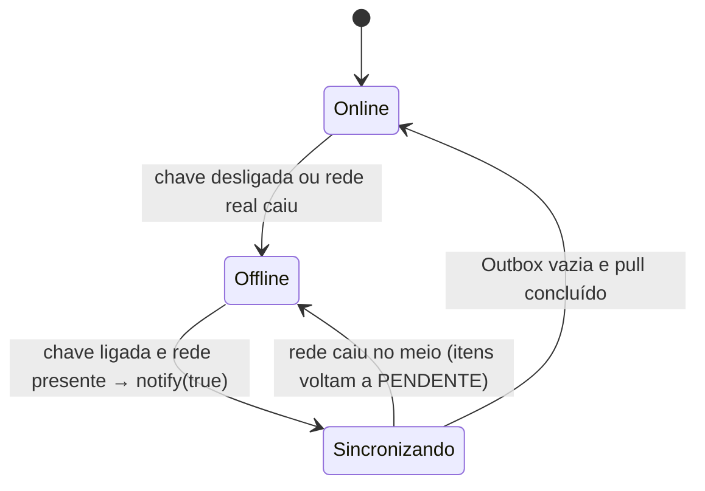
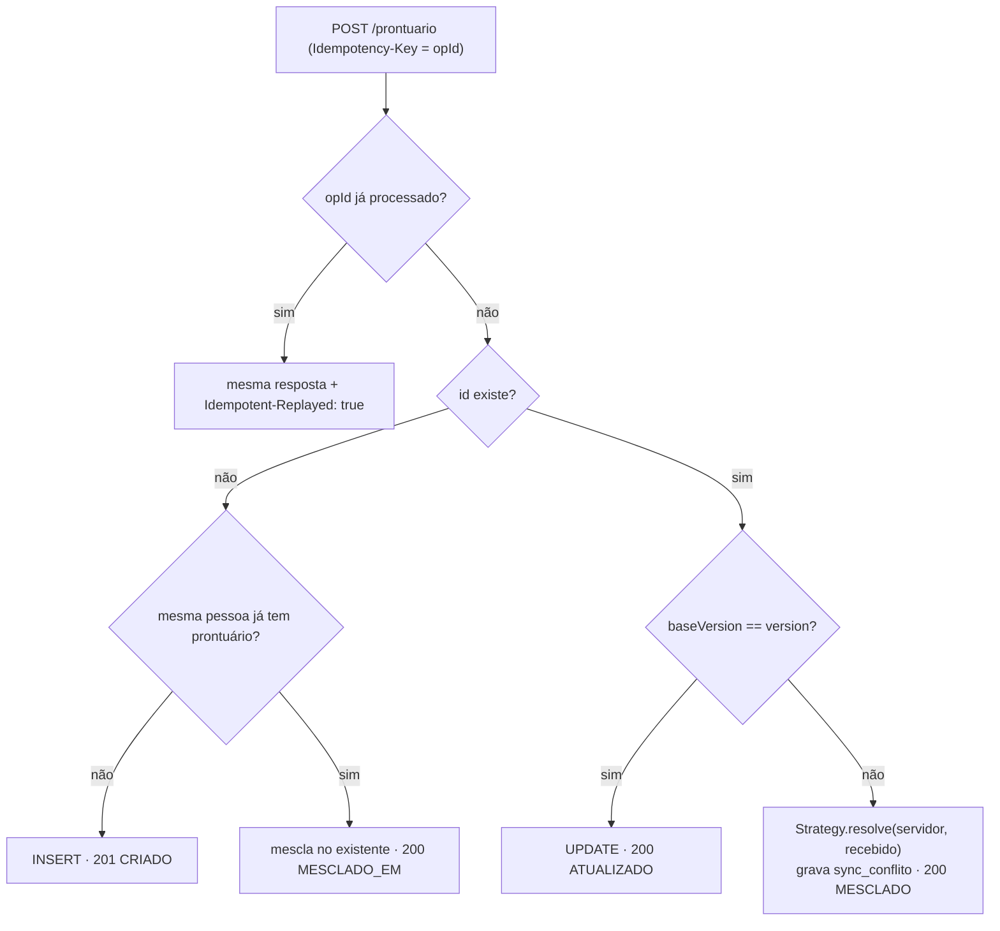
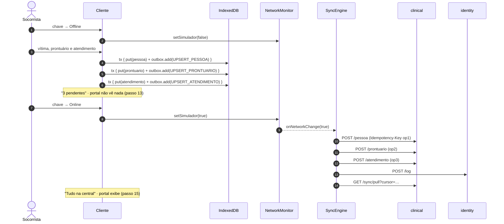

# 03 — Offline-First e Sincronização

Atende RF07, RF08, RF09, RNF02, RNF06, RNF07 e RNF08. Código: `apps/client/src/sync/`, `apps/client/src/services/registro.ts` e `services/clinical-service/src/sync/`.

## 1. Princípios

1. **Local primeiro, sempre.** Toda escrita vai ao IndexedDB e gera um *Command* na Outbox **na mesma transação Dexie**.
2. **IDs gerados no aparelho** (UUID v7): o registro criado offline tem o mesmo id na central.
3. **Cada operação tem um `opId`**, enviado como `Idempotency-Key`. Reenviar nunca duplica.
4. **Pull por cursor** (`change_seq`), controlado pelo servidor e imune a relógio errado.
5. **Conflitos resolvidos por Strategy** e sempre registrados em `sync_conflito`.

## 2. Simulador de conectividade (Observer)



- `NetworkMonitor.isOnline() = simulador && navigator.onLine`.
- Com a chave em **Offline**, o `ApiClient` nem chama `fetch`: falha na hora com `NetworkUnavailableError`, então a demonstração é determinística mesmo com a rede da sala funcionando.
- A casca mostra o estado o tempo todo: a chave (verde/amarela), o contador de pendentes e a **faixa refletiva** quando offline.
- O `SyncEngine` é *Observer*: na transição offline → online ele envia a Outbox e depois recebe as mudanças. Também tenta a cada 30 s se houver pendências, e logo após cada gravação feita online.

## 3. Outbox (Command)

| Campo | Descrição |
|---|---|
| `seq` | autoincremento local: ordem FIFO (vítima → prontuário → atendimento) |
| `opId` | UUID v7 enviado como `Idempotency-Key` |
| `tipo` | `UPSERT_PESSOA`, `UPSERT_PRONTUARIO`, `UPSERT_ATENDIMENTO` |
| `entidadeId`, `payload` | registro afetado e *snapshot* para auditoria |
| `status` | `PENDENTE` → `ENVIANDO` → `CONCLUIDO`, ou `ERRO` (recusa permanente) |
| `tentativas`, `ultimoErro` | controle de reenvio |

- **Coalescência:** uma nova edição de um registro que já tem operação pendente atualiza essa operação em vez de criar outra. Se a operação já tinha sido tentada, ela ganha um `opId` novo, para o servidor não responder a edição nova com a resposta da antiga.
- **Execução:** o *Command* lê o estado **mais recente** do registro local e o envia com `baseVersion = versão conhecida da central`.

```
para cada operação PENDENTE em ordem de seq:
  ENVIANDO → command.execute()
  2xx  → aplica o que o servidor devolveu (versão, mescla) e marca CONCLUIDO
  sem rede / 5xx      → volta a PENDENTE e PARA (preserva a ordem)
  401 sem refresh     → PENDENTE, pede novo login e PARA
  409 DEPENDENCIA_AUSENTE → PENDENTE e PARA
  outro 4xx (422…)    → ERRO (registro marcado “Recusado”) e SEGUE
depois envia os logs locais (POST /log) e faz o pull
```

A tela **Sincronização** lista a Outbox, permite reenviar ou descartar operações recusadas e mostra o cursor de recebimento.

## 4. Pull (receber dados da central)

`GET /sync/pull?cursor={n}&limite=500` devolve medicamentos, hospitais, viaturas, pessoas, prontuários e atendimentos (completos, com sinais, medicamentos e adendos) com `change_seq > cursor`, mais `proximoCursor` e `temMais`.

- Toda tabela sincronizável tem `change_seq`, preenchido por **uma sequência global** através do *trigger* `fn_touch_sync` (`BEFORE INSERT OR UPDATE`). O *trigger* também incrementa `version` e atualiza `atualizado_em`.
- Por ser *trigger*, **um `INSERT` feito à mão no `psql`** (passo 9 do roteiro) também ganha cursor e chega ao aparelho no próximo recebimento — e só o que mudou é transferido.
- O cliente **não sobrescreve** registros que ainda têm operação pendente na Outbox.

## 5. Resolução de conflitos (Strategy)

Há conflito quando chega uma escrita com `baseVersion` menor que a `version` atual (alguém alterou o registro depois que este aparelho o recebeu).



| Entidade | Strategy | Regra |
|---|---|---|
| Medicamento, hospital, viatura | ServerWins | cadastros de apoio só mudam na central |
| Pessoa | FieldMerge | campo a campo; vazio não apaga preenchido; vence a edição clínica mais recente |
| Prontuário | FieldMerge + união | alergias, comorbidades e uso contínuo são **unidos** (alergia nunca se perde) |
| Atendimento (cabeçalho) | LWW, ou ServerWins se já FINALIZADO | atendimento finalizado é imutável |
| Sinais vitais e medicamentos | AppendOnlyUnion | união por id; nada é sobrescrito |

**Vítima cadastrada duas vezes** (mesmo CPF, duas equipes offline): a primeira fica canônica, os dados são mesclados nela, o novo id passa a apontar para ela (`mesclada_em`) e a resposta `MESCLADO_EM` traz `idCanonico`. O cliente reaponta prontuário e atendimentos locais.

**Relógio do aparelho:** o cliente envia `X-Client-Time`; a diferença é gravada no conflito (`offset_relogio_ms`) para auditoria.

O teste e2e do clinical-service prova cada caso: idempotência, mescla de alergias, finalizado imutável, união de sinais e dependência ausente.

## 6. Regras de segurança clínica sem rede

A `ClinicalSafetyChain` (`packages/shared`) roda no aparelho ao registrar cada medicamento e é **revalidada no servidor** para administrações novas:

| Regra | Severidade |
|---|---|
| Medicamento inativo | aviso |
| Controlado registrado por socorrista | bloqueia |
| Via não permitida | bloqueia |
| Dose acima da máxima por administração | bloqueia |
| Soma no atendimento acima da dose máxima diária | bloqueia |
| Alergia do prontuário × alérgenos do medicamento | bloqueia, mas aceita **justificativa clínica** (gravada na ficha) |
| Intervalo mínimo entre doses | aviso |

Os alertas exibidos e os justificados viram logs do aparelho (`ALERTA_CLINICO_EXIBIDO`, `ALERTA_CLINICO_IGNORADO`).

## 7. Autenticação offline

1. No primeiro login **com rede**, o aparelho guarda `PBKDF2(senha, salt, 150 000)` e o perfil.
2. Sem rede, o login confere o hash localmente e abre uma sessão offline.
3. Todo registro guarda `registradoPor` (quem atendeu) e `dispositivoId`. Ao sincronizar, a central grava também `sincronizado_por` (dono do token).
4. Na volta da rede, o `refresh token` renova o acesso; se expirou, o aparelho pede login antes de enviar.

## 8. Logs do aparelho (`POST /log`)

Login offline/online, troca de rede, vítima/prontuário/atendimento criados ou alterados, alertas clínicos e erros de sincronização ficam em `logsLocais` com `detalhes.offline`. São enviados em lotes idempotentes ao identity-service e aparecem em **Portal → Auditoria → Ações nos dispositivos**.

## 9. Sequência dos passos 12 a 15


