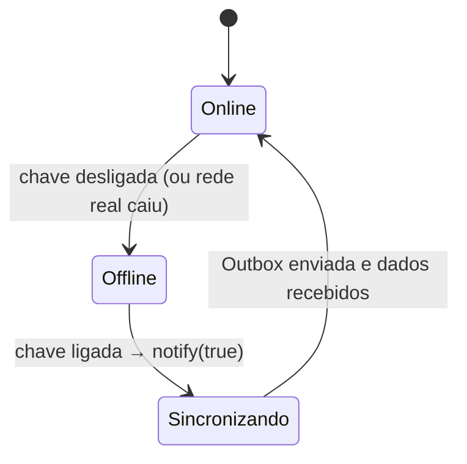
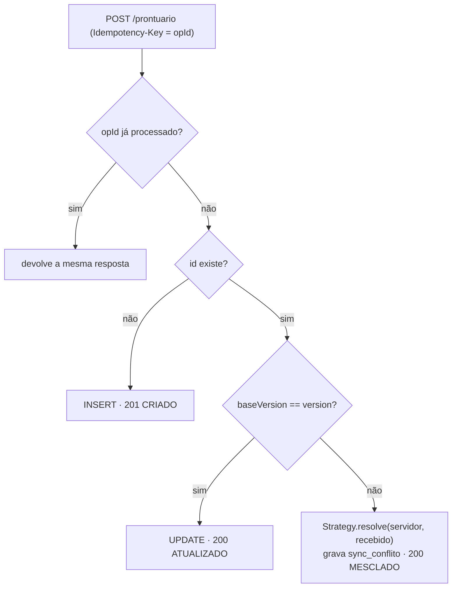
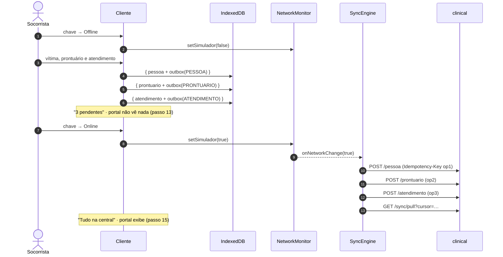

# 03 — Offline-First e Sincronização

Código: `apps/client/src/sync/`, `apps/client/src/services/registro.ts` e `services/clinical-service/src/sync/`.

## 1. Princípios

1. **Local primeiro, sempre.** Toda escrita vai ao IndexedDB e gera um *Command* na Outbox **na mesma transação**.
2. **IDs gerados no aparelho** (UUID v7): o registro criado offline tem o mesmo id na central.
3. **Cada operação tem um `opId`**, enviado como `Idempotency-Key`. Reenviar nunca duplica.
4. **Recebimento por cursor** (`change_seq`), controlado pelo servidor.
5. **Conflitos resolvidos por Strategy** e registrados em `sync_conflito`.

## 2. Simulador de conectividade (Observer)



- `NetworkMonitor.isOnline() = chave ligada && navigator.onLine`.
- Com a chave em **Offline**, o cliente HTTP nem chama `fetch`: falha na hora com `SemConexaoError`. Assim a demonstração funciona mesmo com a rede da sala ligada.
- A barra superior mostra o estado o tempo todo: a chave (verde/amarela), o contador de pendentes e a **faixa amarela e preta** quando offline.
- O `SyncEngine` é o *Observer*: na passagem offline → online ele envia a Outbox e depois recebe as mudanças. Estando online, também envia logo após cada gravação.

## 3. Outbox (Command)

| Campo | Descrição |
|---|---|
| `seq` | autoincremento local: ordem de envio (vítima → prontuário → atendimento) |
| `opId` | UUID v7 enviado como `Idempotency-Key` |
| `tipo` | `PESSOA`, `PRONTUARIO`, `ATENDIMENTO` |
| `entidadeId` | registro afetado |
| `status` | `PENDENTE` → `CONCLUIDO`, ou `ERRO` (recusa definitiva) |

O *Command* lê o estado **mais recente** do registro local e envia com `baseVersion` (versão que o aparelho conhecia da central).

```
para cada operação PENDENTE, na ordem de seq:
  2xx              → grava o que o servidor devolveu e marca CONCLUIDO
  sem rede / 5xx   → para (tenta de novo depois, mantendo a ordem)
  401 / 409        → para (sem login ou dependência ainda não enviada)
  outro 4xx (422…) → ERRO (registro aparece como "Recusado") e segue
depois envia os logs do aparelho (POST /log)
```

## 4. Receber dados da central

`GET /sync/pull?cursor={n}` devolve medicamentos, pessoas, prontuários e atendimentos com `change_seq > cursor`, e o `proximoCursor`.

- Cada tabela sincronizável tem `change_seq`, preenchido por **uma sequência global** através do *trigger* `fn_touch_sync`. O *trigger* também incrementa `version`.
- Por ser *trigger*, **um `INSERT` feito à mão no `psql`** (passo 9 do roteiro) também ganha cursor e chega ao aparelho no próximo recebimento — só o que mudou é transferido.
- O cliente **não sobrescreve** registros que ainda têm operação pendente na Outbox.

## 5. Resolução de conflitos (Strategy)

Há conflito quando chega uma escrita com `baseVersion` menor que a `version` atual (alguém alterou o registro depois que este aparelho o recebeu).



| Entidade | Strategy | Regra |
|---|---|---|
| Pessoa | `LastWriteWinsStrategy` | vence a edição mais recente (`atualizadoEmCliente`) |
| Prontuário | `MergeStrategy` | alergias e comorbidades são **unidas** — uma alergia nunca se perde |
| Atendimento | `ServerWinsStrategy` | atendimento registrado não muda: prevalece o da central |

## 6. Regras de segurança clínica sem rede

A cadeia de regras (`packages/shared/src/clinical/safety.ts`, *Chain of Responsibility*) roda no aparelho ao adicionar cada medicamento e é **conferida de novo no servidor** (422 `REGRA_CLINICA`):

| Regra | Efeito |
|---|---|
| Via não permitida para o medicamento | bloqueia |
| Dose acima da dose máxima | bloqueia |
| Alergia do prontuário × nome/alérgenos do medicamento | bloqueia |

## 7. Logs do aparelho (`POST /log`)

Login, troca de rede e registros criados ou alterados viram logs no aparelho (`logsLocais`), inclusive offline. São enviados ao identity-service junto com a sincronização e ficam na tabela `identity.log_cliente`.

## 8. Sequência dos passos 12 a 15


