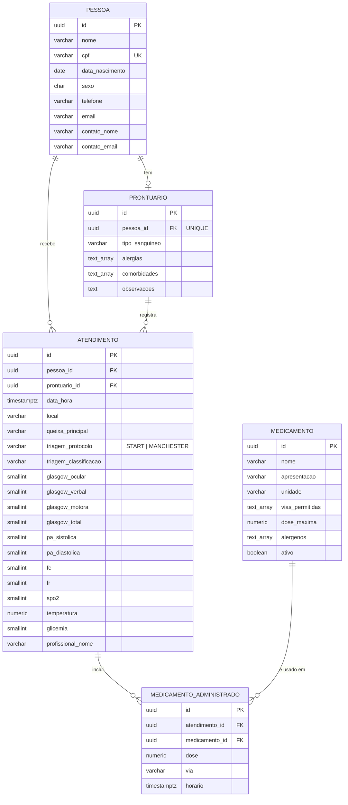
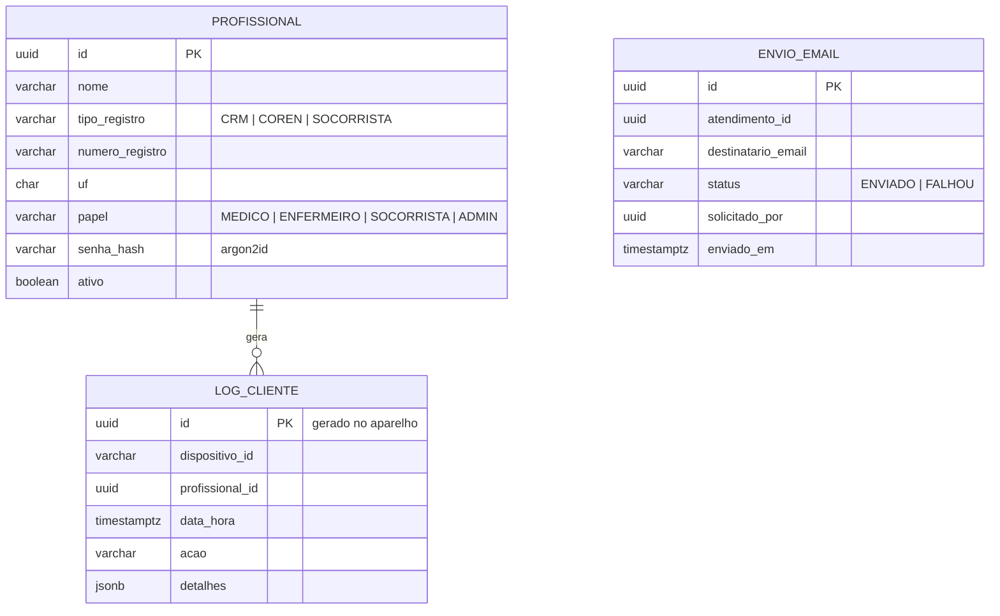

# 05 — Modelagem dos Bancos de Dados (Entregável E2, parte 2)

Persistência dual: **PostgreSQL 16** na VM (central) e **IndexedDB/Dexie** no aparelho (embarcado).

## 1. Banco central

| Schema | Usuário | Migração | Tabelas |
|---|---|---|---|
| `identity` | `mf_identity` | Flyway (`services/identity-service/src/main/resources/db/migration`) | `profissional`, `log_cliente`, `access_log` |
| `clinical` | `mf_clinical` | `services/clinical-service/migrations/001_schema.sql` | `pessoa`, `prontuario`, `atendimento`, `medicamento_administrado`, `medicamento`, `processed_operation`, `sync_conflito`, `access_log` |
| `document` | `mf_document` | `services/document-service/migrations/001_schema.sql` | `envio_email`, `access_log` |

Banco, usuários e *schemas*: `infra/db/init.sql`. Cada usuário só acessa o próprio *schema*. Referências entre serviços (ex.: `registrado_por` → profissional) são lógicas, sem chave estrangeira.

### Colunas de sincronização (`clinical`)

| Coluna | Finalidade |
|---|---|
| `id UUID` | gerado no aparelho (v7) |
| `version INT` | versão do registro; incrementada pelo *trigger* |
| `change_seq BIGINT` | cursor global de sincronização (*trigger*) |
| `atualizado_em_cliente` | hora da edição no aparelho (usada no Last-Write-Wins) |
| `registrado_por`, `dispositivo_id`, `criado_offline` | quem registrou, em qual aparelho, e se foi sem rede |
| `sincronizado_em` | quando chegou à central |

```sql
CREATE SEQUENCE change_seq_global;
CREATE FUNCTION fn_touch_sync() RETURNS trigger AS $$
BEGIN
  NEW.change_seq := nextval('change_seq_global');
  IF TG_OP = 'UPDATE' AND NEW.version = OLD.version THEN
    NEW.version := OLD.version + 1;
  END IF;
  RETURN NEW;
END $$ LANGUAGE plpgsql;
-- BEFORE INSERT OR UPDATE em medicamento, pessoa, prontuario e atendimento
```

### Modelo clínico



### Sincronização (`clinical`)

| Tabela | Uso |
|---|---|
| `processed_operation` | `op_id` (Idempotency-Key) → status e resposta gravados; reenvio devolve a mesma resposta |
| `sync_conflito` | entidade, estratégia, valor do servidor, valor recebido e resultado de cada conflito |

### Identidade e documentos



### Log de acesso (os três *schemas*)

`access_log(id, data_hora, ip_cliente, profissional_id, metodo, rota, status_code, tempo_ms)` — uma linha por requisição.

## 2. Banco do aparelho (IndexedDB / Dexie)

`apps/client/src/data/db.ts`. No aparelho, sinais vitais e medicamentos ficam dentro do documento do atendimento.

```ts
this.version(1).stores({
  pessoas:      'id, nome',
  prontuarios:  'id, pessoaId',
  atendimentos: 'id, pessoaId, dataHora',
  medicamentos: 'id, nome',
  outbox:       '++seq, status, entidadeId',
  logsLocais:   'id, enviado',
  meta:         'chave',          // cursor, último envio/recebimento
});
```

| Tabela | Conteúdo |
|---|---|
| `pessoas`, `prontuarios`, `atendimentos` | registros com `syncStatus` (`PENDENTE`, `SINCRONIZADO`, `ERRO`) |
| `medicamentos` | catálogo (as regras clínicas funcionam offline) |
| `outbox` | operações a enviar ([03 §3](03-sincronizacao-offline.md#3-outbox-command)) |
| `logsLocais` | logs do aparelho ainda não enviados |
| `meta` | cursor de recebimento e datas da última sincronização |

## 3. Dados de demonstração

- **identity** (`SeedRunner`): 4 profissionais — ADMIN `SOCORRISTA 0001`, Dra. Ana Souza `CRM 12345/RS`, Enf. Bruno Lima `COREN 54321/RS`, Carla Mendes `SOCORRISTA 2048`. Senha de todos: `medicalfield`.
- **clinical** (`seeds/demo.sql`): 8 medicamentos, 2 pacientes com prontuário (João Pedro tem alergia a Dipirona) e 2 atendimentos.
- **Passo 9 do roteiro**: `infra/db/roteiro/passo-09-novos-medicamentos.sql` insere Cetoprofeno e Salbutamol direto no banco.
