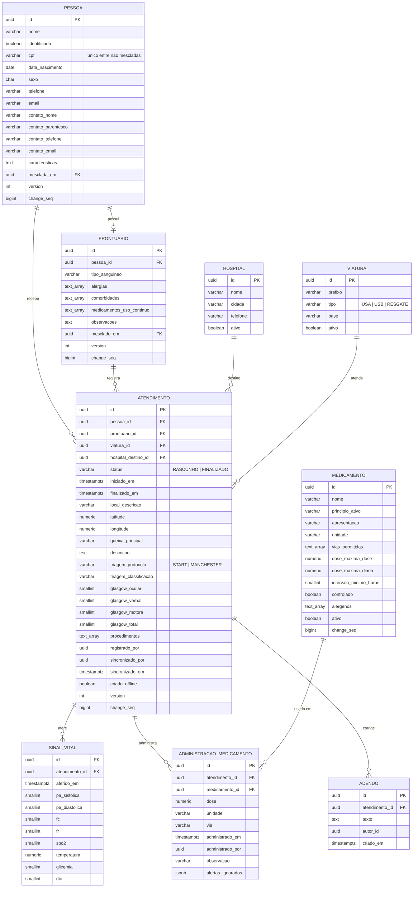
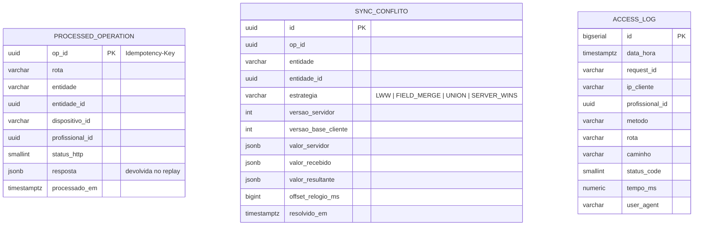
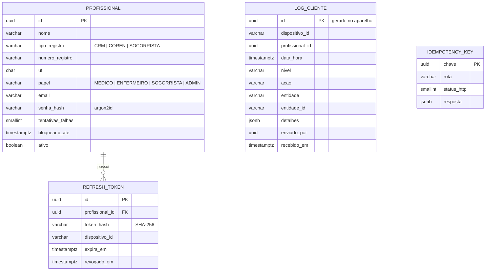
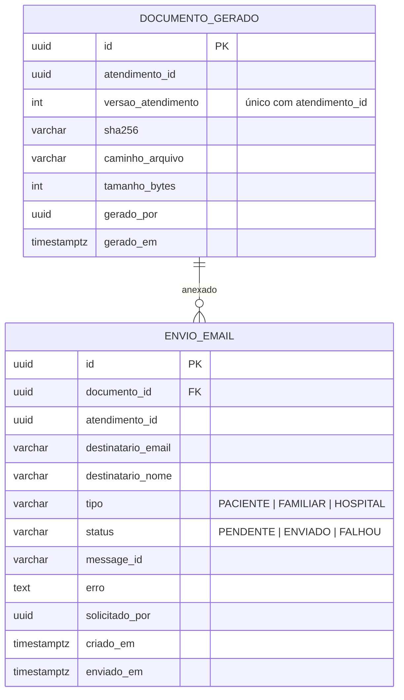

# 05 — Modelagem dos Bancos de Dados (Entregável E2, parte 2)

Persistência dual: **PostgreSQL 16** na VM (central) e **IndexedDB/Dexie** no aparelho (embarcado).

## 1. Banco central

| Schema | Usuário | Migração | Tabelas |
|---|---|---|---|
| `identity` | `mf_identity` | Flyway (`services/identity-service/src/main/resources/db/migration`) | `profissional`, `refresh_token`, `log_cliente`, `idempotency_key`, `access_log` |
| `clinical` | `mf_clinical` | `services/clinical-service/migrations/*.sql` | `pessoa`, `prontuario`, `atendimento`, `sinal_vital`, `administracao_medicamento`, `adendo`, `medicamento`, `hospital`, `viatura`, `processed_operation`, `sync_conflito`, `access_log` |
| `document` | `mf_document` | `services/document-service/migrations/001_schema.sql` | `documento_gerado`, `envio_email`, `idempotency_key`, `access_log` |

Criação de banco, usuários e *schemas*: `infra/db/init.sql`. Cada usuário só acessa o próprio *schema*. Referências entre serviços (ex.: `registrado_por` → profissional) são lógicas, sem chave estrangeira física.

### Colunas de sincronização (`clinical`)

| Coluna | Finalidade |
|---|---|
| `id UUID` | gerado no aparelho (v7) |
| `version INT` | controle otimista; incrementado pelo *trigger* |
| `change_seq BIGINT` | cursor global de sincronização (*trigger*) |
| `atualizado_em_cliente` | hora clínica informada no aparelho (usada no LWW) |
| `registrado_por` / `sincronizado_por` | quem registrou × quem enviou |
| `dispositivo_id`, `criado_offline` | origem do registro |
| `mesclada_em` / `mesclado_em` | duplicata apontando para o registro canônico |

```sql
CREATE SEQUENCE change_seq_global;
CREATE FUNCTION fn_touch_sync() RETURNS trigger AS $$
BEGIN
  NEW.change_seq    := nextval('change_seq_global');
  NEW.atualizado_em := now();
  IF TG_OP = 'UPDATE' AND NEW.version = OLD.version THEN NEW.version := OLD.version + 1; END IF;
  RETURN NEW;
END $$ LANGUAGE plpgsql;
-- aplicado (BEFORE INSERT OR UPDATE) em medicamento, hospital, viatura, pessoa, prontuario, atendimento
```

## 2. Diagrama ER — `clinical`



### Sincronização e auditoria (`clinical`)



## 3. Schema `identity`


Índice único `(tipo_registro, numero_registro, COALESCE(uf,''))`. `access_log` igual ao do `clinical`.

## 4. Schema `document`


Mais `idempotency_key` e `access_log`. Os PDFs ficam em `FICHAS_DIR` e são reaproveitados enquanto a versão do atendimento não muda.

## 5. Banco embarcado — IndexedDB (Dexie)

`apps/client/src/data/db.ts`. No aparelho, sinais vitais e medicamentos ficam dentro do documento do atendimento; o servidor normaliza.

```ts
this.version(1).stores({
  pessoas:      'id, cpf, nome, syncStatus, mescladaEm',
  prontuarios:  'id, pessoaId, syncStatus',
  atendimentos: 'id, pessoaId, prontuarioId, status, syncStatus, iniciadoEm',
  medicamentos: 'id, nome, ativo',
  hospitais:    'id, nome',
  viaturas:     'id, prefixo',
  outbox:       '++seq, &opId, status, tipo, entidadeId',
  logsLocais:   'id, enviado, dataHora',
  credenciais:  'chave',   // login offline: salt + hash PBKDF2 + perfil
  meta:         'chave',   // syncCursor, ultimaSync, ultimoRecebimento
});
```

| Tabela | Conteúdo | Estado |
|---|---|---|
| `pessoas`, `prontuarios`, `atendimentos` | registros do aparelho e recebidos | `syncStatus`: `PENDENTE` · `SINCRONIZADO` · `ERRO` |
| `medicamentos`, `hospitais`, `viaturas` | cache dos cadastros (regras clínicas offline) | — |
| `outbox` | Commands a enviar | `PENDENTE` · `ENVIANDO` · `CONCLUIDO` · `ERRO` |
| `logsLocais` | ações para `POST /log` | `enviado` 0/1 |

## 6. Dados de demonstração

- **identity:** 4 profissionais com ids fixos — Central de Regulação (`SOCORRISTA 0001`, ADMIN), Dra. Ana Souza (`CRM 12345/RS`), Enf. Bruno Lima (`COREN 54321/RS`), Carla Mendes (`SOCORRISTA 2048`). Senha: `MEDICALFIELD_SEED_SENHA` (padrão `medicalfield`).
- **clinical** (`seeds/demo.sql`): 10 medicamentos, 3 hospitais, 2 viaturas, 2 pacientes com prontuário e 1 atendimento cada.
- **Passo 9:** `infra/db/roteiro/passo-09-novos-medicamentos.sql` insere Cetoprofeno e Salbutamol.

Todos os pacientes, CPFs, telefones e e-mails são **fictícios**.
