# 06 — Roteiro de Testes (Entregável E3)

Os 17 passos oficiais, com a ação, a API envolvida e o resultado esperado. O roteiro inteiro também roda **automaticamente no navegador** (`tests/e2e/roteiro.mjs`), com o portal e o cliente lado a lado. Última execução: **17/17 aprovados** sobre o banco zerado. As capturas abaixo são dessa execução.

## Preparação

| # | Item | Como |
|---|---|---|
| P1 | Banco zerado com dados de demonstração | `infra/scripts/reset-db.sh` e `infra/scripts/start-all.sh` (na VM: [07](07-implantacao-vm.md)) |
| P2 | Duas janelas | Portal (`/portal`) à esquerda; cliente (`/app`) à direita, ou no celular |
| P3 | Terminal com `psql` | para o passo 9 |
| P4 | Postman | `postman/MedicalField.postman_collection.json` (opcional, para mostrar as rotas) |

| Acesso | Tipo | Número | Senha (demo) |
|---|---|---|---|
| Portal (regulação) | ID Socorrista | `0001` | `medicalfield` |
| Cliente (médica) | CRM | `12345` / RS | `medicalfield` |
| Cliente (enfermeiro) | COREN | `54321` / RS | `medicalfield` |
| Cliente (socorrista) | ID Socorrista | `2048` | `medicalfield` |

## Passos

| # | Onde | Ação | API | Resultado esperado |
|---|---|---|---|---|
| 1 | Portal | Entrar com `0001` | `POST /auth/login` | Tela de atendimentos. Senha errada mostra a mensagem e grava 401 no log de acesso. |
| 2 | Portal | **Cadastros** (Medicamentos, Profissionais, Hospitais, Viaturas) | `GET /medicamento`, `/profissional`, `/apoio/*` | 10 medicamentos, 4 profissionais, 3 hospitais, 2 viaturas. |
| 3 | Portal | **Prontuários** | `GET /prontuario` | 2 prontuários (alergia em vermelho). |
| 4 | Portal | **Atendimentos** | `GET /atendimento` | 2 atendimentos com etiqueta de triagem. |
| 5 | Cliente | Chave em Online; entrar com CRM 12345/RS | `POST /auth/login` | Lista de ocorrências. O aparelho fica liberado para login offline. |
| 6 | Cliente | **Sincronização → Receber dados da central** | `GET /sync/pull?cursor=0` | “10 medicamentos”, pacientes e atendimentos no aparelho. |
| 7 | Cliente | **Online:** Pacientes → João → Novo atendimento → preencher → **Finalizar** | `POST /atendimento` | Selo “Na central” logo em seguida (Outbox drenada na hora). |
| 8 | Portal | Atendimentos → **Atualizar** | `GET /atendimento` | O atendimento do passo 7 aparece; o detalhe mostra sinais e medicamento. |
| 9 | Banco | `psql … -f infra/db/roteiro/passo-09-novos-medicamentos.sql` | — (SQL) | Cetoprofeno e Salbutamol inseridos; o *trigger* preenche `change_seq`. |
| 10 | Portal | Atendimentos (e Cadastros) | `GET /atendimento`, `/medicamento` | Atendimentos inalterados; 12 medicamentos em Cadastros. |
| 11 | Cliente | Receber dados da central | `GET /sync/pull?cursor=<último>` | “12 medicamentos”: só o que mudou foi transferido. |
| 12 | Cliente | **Chave em Offline** (faixa refletiva). Nova ocorrência → vítima (CPF, contato com e-mail) → prontuário (alergia **Dipirona**) → atendimento (Manchester Laranja). Tentar **Dipirona** → alerta de alergia bloqueia. Registrar outro medicamento → Finalizar. | nenhuma (sem rede) | “3 pendentes”; registros com selos “Registrado offline” e “Só no aparelho”. |
| 13 | Portal | Prontuários e Atendimentos → Atualizar | `GET /prontuario`, `/atendimento` | A vítima do passo 12 **não** aparece. |
| 14 | Cliente | **Chave em Online** | `POST /pessoa`, `/prontuario`, `/atendimento`, `/log`, `GET /sync/pull` | Envio automático (Observer). Casca: “Tudo na central”. |
| 15 | Portal | Prontuários e Atendimentos → Atualizar | `GET /prontuario`, `/atendimento` | A vítima **aparece**, com o selo “Registrado offline”. |
| 16 | Portal (ou cliente) | Abrir o atendimento → **Gerar ficha (PDF)** | `GET /ficha/{id}/pdf` | PDF abre em nova aba; a tela mostra a emissão com o SHA-256. |
| 17 | Portal (ou cliente) | **Enviar ficha** para o familiar sugerido | `POST /ficha/{id}/email` | “Enviada para Ana Ramos”; e-mail com o PDF anexo (caixa real com SMTP, ou `.eml` em `MAIL_OUTBOX_DIR`). |

## Capturas da execução

| Passo | Captura |
|---|---|
| 4 — Portal, atendimentos | 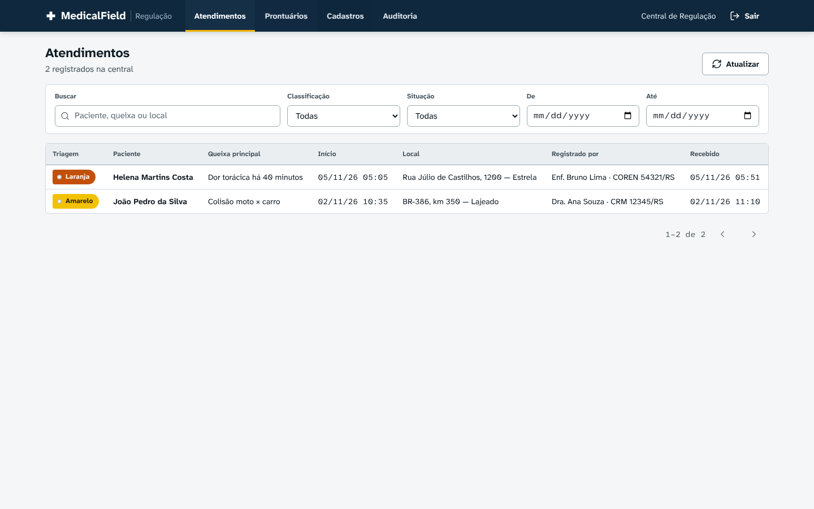 |
| 7 — Cliente online | 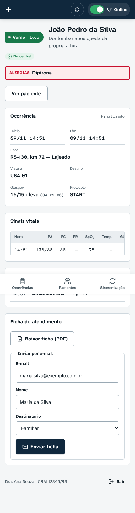 |
| 12 — Vítima registrada offline | 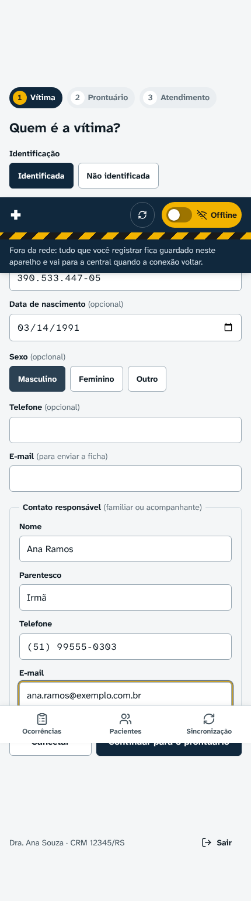 |
| 12 — Alerta de alergia sem rede | 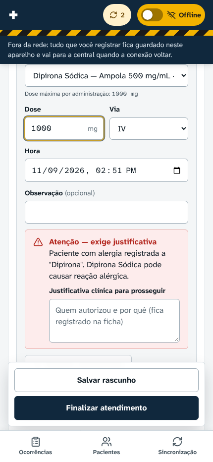 |
| 12 — Três pendentes | 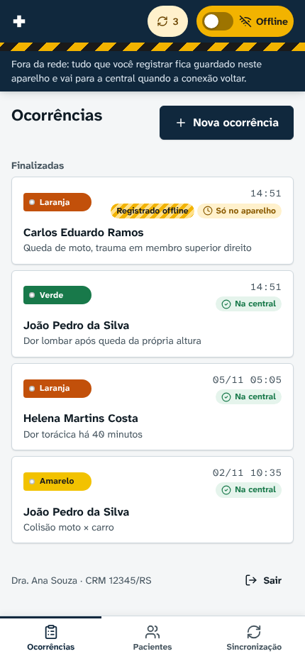 |
| 13 — Portal ainda sem a vítima | 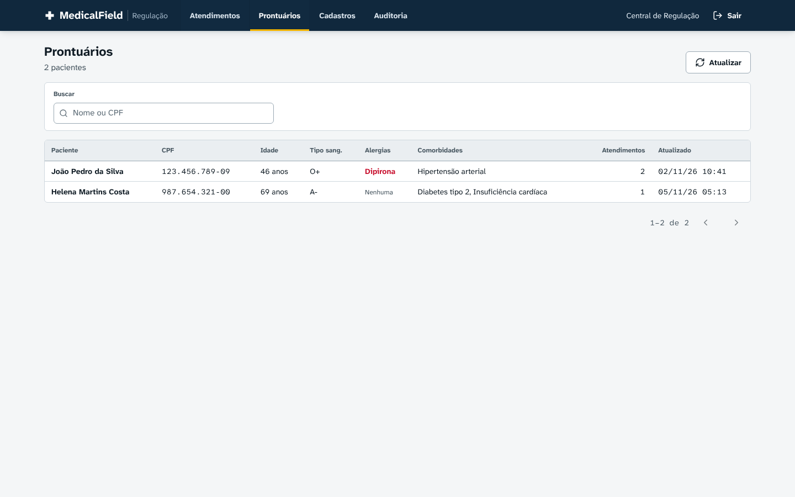 |
| 14 — Sincronizado ao religar | 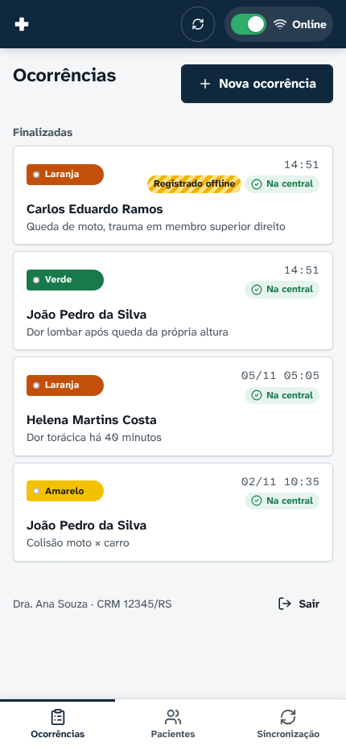 |
| 15 — Portal com a vítima | 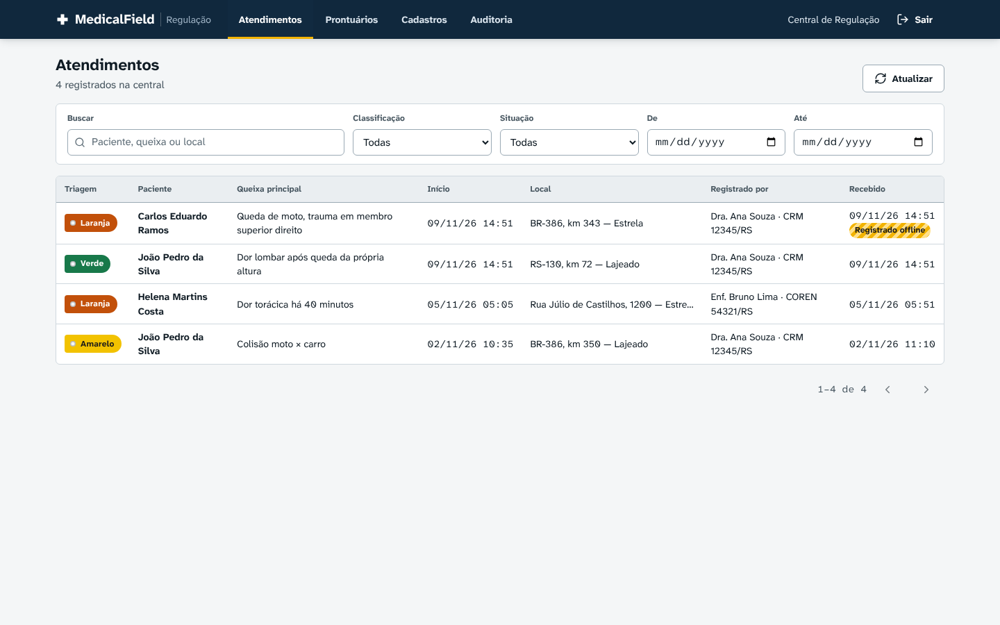 |
| 16 — Ficha emitida | 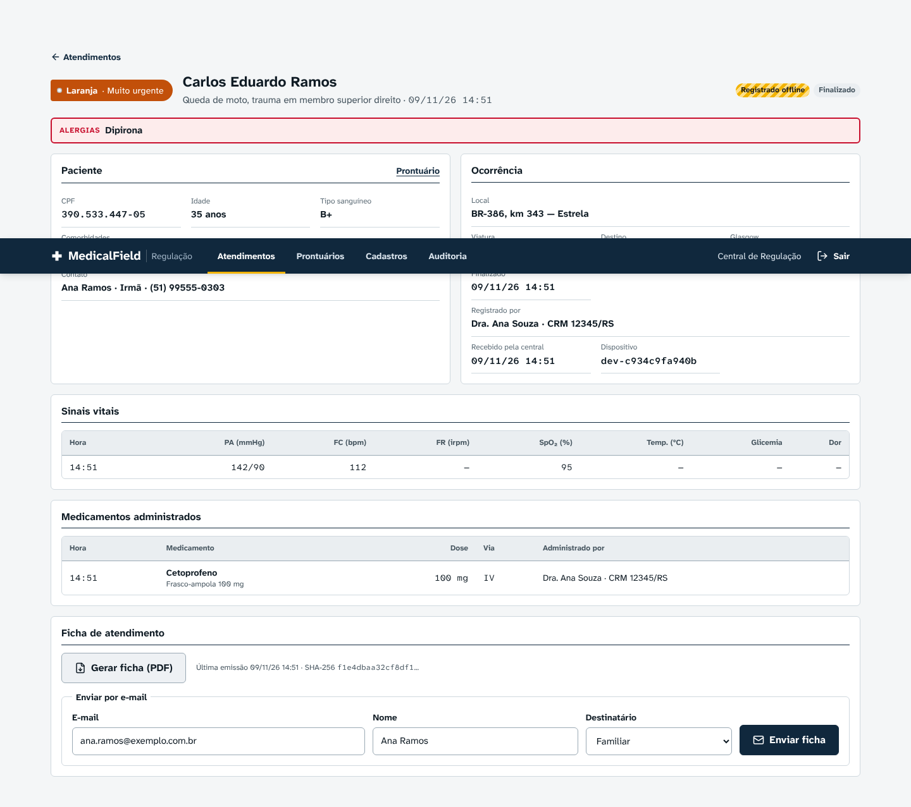 |
| 17 — E-mail enviado | 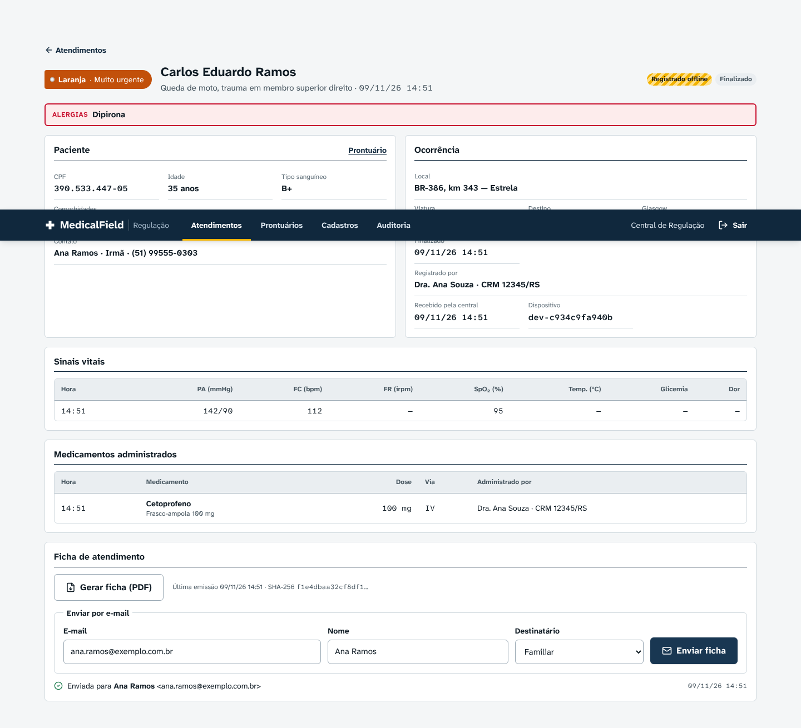 |
| Ficha em PDF | 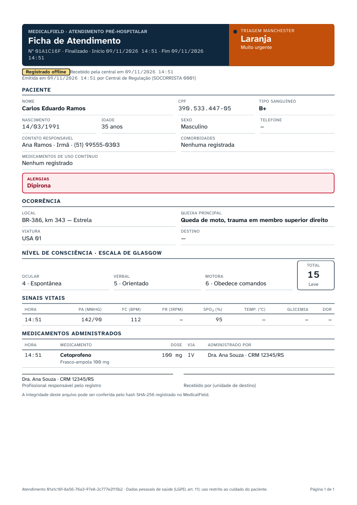 |

## Demonstrações extras

| Demonstração | Como |
|---|---|
| Idempotência | No Postman, repetir `POST /atendimento` com a mesma `Idempotency-Key`: mesma resposta e `Idempotent-Replayed: true`, sem duplicar. |
| Rota protegida | `GET /api/medicamento` sem token → 401, registrado no log de acesso “não autenticado”. |
| Log de acesso | Portal → Auditoria → Acessos às APIs (escolher o serviço Java, TypeScript ou Python). |
| Logs offline | Portal → Auditoria → Ações nos dispositivos: ações do passo 12 com o selo “Offline”. |
| Conflito | Dois navegadores offline editam as alergias do mesmo prontuário; ao sincronizar, as alergias são **unidas** e o conflito aparece em Auditoria → Conflitos. |
| Queda no meio | Desligar a chave durante o envio: os itens voltam a pendente e completam sem duplicar ao religar. |

## Rodar o roteiro automático

```bash
infra/scripts/reset-db.sh && infra/scripts/start-all.sh
cd tests/e2e && npm install && npx playwright install chromium
node roteiro.mjs            # MF_URL=http://<vm> para rodar contra a VM
```

## Testes automatizados

| Componente | Ferramenta | Comando | Cobre |
|---|---|---|---|
| `packages/shared` | Vitest | `npm test -w @medicalfield/shared` | `ClinicalSafetyChain` (dose máxima/diária, alergia, via, intervalo, controlado), schemas (Glasgow, triagem, CPF) |
| clinical-service | Vitest | `npm test -w @medicalfield/clinical-service` | Strategies de conflito, validação do JWT; e2e (com `E2E_URL`): idempotência, mescla de alergias, finalizado imutável, união de sinais, dependência ausente, regra clínica no servidor, pull por cursor |
| identity-service | JUnit 5 + Mockito | `mvn test` | Login por tipo de registro, bloqueio após 5 tentativas, JWT adulterado |
| document-service | Pytest + aiosmtpd | `.venv/bin/pytest` | PDF gerado pelo Builder, adapter de arquivo, entrega SMTP real, validação RS256 |
| Sistema | Playwright | `node tests/e2e/roteiro.mjs` | os 17 passos |
