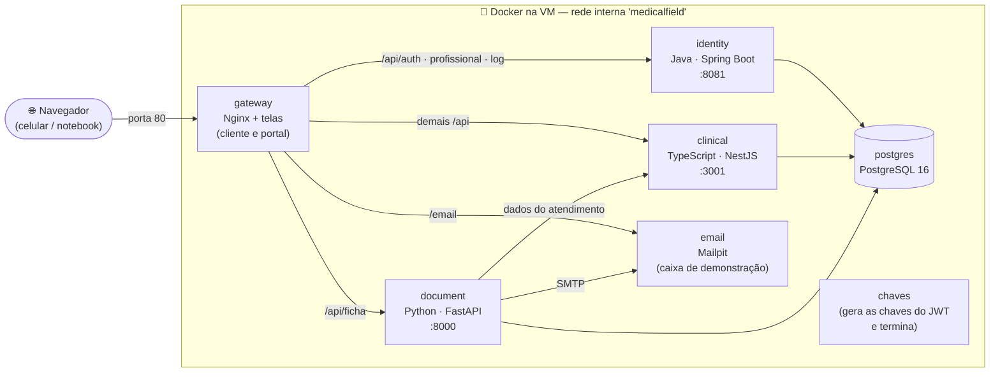

# 07 — Implantação na VM da Univates (Docker)

O sistema inteiro roda em **containers Docker**, descritos num único arquivo: [`docker-compose.yml`](../docker-compose.yml). Todos os comandos do dia a dia estão em [`mf.sh`](../mf.sh).

## 1. Containers



| Container | Imagem | O que faz |
|---|---|---|
| `gateway` | construída de `infra/docker/gateway/Dockerfile` | Nginx: serve o **cliente** (`/app`) e o **portal** (`/portal`) e encaminha `/api/*` aos serviços. É o **único com porta aberta** (80). |
| `identity` | `services/identity-service/Dockerfile` | Java 21 · Spring Boot — login, profissionais, logs do aparelho |
| `clinical` | `services/clinical-service/Dockerfile` | TypeScript · NestJS — pessoas, prontuários, atendimentos, sincronização |
| `document` | `services/document-service/Dockerfile` | Python · FastAPI — ficha em PDF e e-mail |
| `postgres` | `postgres:16-alpine` | Banco central; um *schema* e um usuário por serviço (`infra/db/init.sql`) |
| `email` | `axllent/mailpit` | Caixa de e-mails da demonstração, em `/email/` |
| `chaves` | `alpine/openssl` | Gera o par de chaves RSA do JWT na primeira subida e termina |

Cada Dockerfile tem **duas etapas**: uma compila (Maven, npm) e a outra fica só com o necessário para rodar. Os dados ficam em **volumes**: `banco` (PostgreSQL), `chaves` (JWT) e `emails`.

## 2. Primeira instalação na VM

No seu computador, entre na VM por SSH (troque `<IP-da-VM>` pelo endereço recebido por e-mail):

```bash
ssh univates@<IP-da-VM>
passwd                      # no primeiro acesso: troque a senha
```

Na VM:

```bash
sudo apt-get update && sudo apt-get install -y git
git clone https://github.com/joaogehlen/MedicalField.git
cd MedicalField
./mf.sh instalar-docker                     # instala o Docker (e swap, se a VM tiver pouca memória)
MF_ENDERECO=<IP-da-VM> ./mf.sh subir        # constrói as imagens e sobe tudo (~10 min na 1ª vez)
```

No fim aparecem os links:

| O quê | Endereço | Login |
|---|---|---|
| Cliente (socorrista) | `http://<IP-da-VM>/app/` | CRM `12345` / RS · senha `medicalfield` |
| Portal (central) | `http://<IP-da-VM>/portal/` | Socorrista `0001` · senha `medicalfield` |
| Caixa de e-mails | `http://<IP-da-VM>/email/` | — |
| API (Postman) | `http://<IP-da-VM>/api` | variável `baseUrl` da coleção |

Na primeira subida, `./mf.sh` cria o arquivo `.env` com **senhas aleatórias** do banco (ele não vai para o GitHub). As migrações criam as tabelas e os dados de demonstração.

## 3. Comandos (`./mf.sh`)

| Comando | O que faz |
|---|---|
| `./mf.sh subir` | constrói e sobe todos os containers |
| `./mf.sh status` | lista os containers e o estado de cada um |
| `./mf.sh enderecos` | mostra os links |
| `./mf.sh logs clinical` | acompanha o log de um serviço (`identity`, `clinical`, `document`, `gateway`, `postgres`) |
| `./mf.sh passo9` | **passo 9 do roteiro**: insere Cetoprofeno e Salbutamol direto no banco |
| `./mf.sh acessos clinical` | últimas linhas do **log de acesso** de um serviço |
| `./mf.sh banco` | abre o `psql` no banco |
| `./mf.sh zerar` | apaga os dados e volta à demonstração inicial (antes de ensaiar o roteiro) |
| `./mf.sh parar` | para tudo (os dados ficam guardados) |
| `./mf.sh atualizar` | `git pull` + subir de novo |

Os containers têm `restart: unless-stopped`: se a VM reiniciar, o sistema volta sozinho.

## 4. E-mail

Por padrão o document-service entrega os e-mails ao container **Mailpit**: abra `http://<IP-da-VM>/email/` para ver a mensagem com a ficha em PDF anexa (ótimo para a apresentação, sem depender de conta de e-mail).

Para envio real (ex.: Gmail com senha de app), descomente e preencha os `SMTP_*` do arquivo `.env` na VM e rode `./mf.sh subir`. Teste cedo: algumas redes bloqueiam a porta 587.

## 5. Problemas comuns

| Sintoma | Solução |
|---|---|
| `permission denied ... docker.sock` | O `mf.sh` usa `sudo` sozinho; para não precisar, saia e entre de novo no SSH depois do `instalar-docker`. |
| Build parou com `Killed` | Pouca memória. Rode `./mf.sh instalar-docker` (cria swap) e `./mf.sh subir` de novo. |
| A página não abre de fora, mas `./mf.sh status` mostra tudo `Up` | A porta 80 pode estar fechada no firewall da Univates. Teste outra: `PORTA=8080` no `.env`, `./mf.sh subir` e acesse `http://<IP-da-VM>:8080/portal/`. |
| `port is already allocated` | Outro programa usa a porta 80 (`sudo ss -ltnp | grep :80`). Pare-o ou troque `PORTA` no `.env`. |
| Um serviço reinicia sem parar | `./mf.sh logs <serviço>` mostra o erro. |

## 6. Sem Docker (alternativa)

Os scripts originais continuam no projeto para rodar direto no sistema operacional (Nginx + systemd): `sudo infra/scripts/deploy-vm.sh` na VM, ou `infra/scripts/start-all.sh` para desenvolvimento local (ver [COMO-RODAR.md](../COMO-RODAR.md)).
